<a href="https://github.com/MarufxAlchemist?tab=repositories&q=astrosentinel">astrosentinel</a> ·
<a href="https://github.com/MarufxAlchemist?tab=repositories&q=risk">risk engine</a> ·
<a href="https://github.com/MarufxAlchemist?tab=repositories&q=loreshire">loreshire</a> ·
<a href="https://github.com/MarufxAlchemist?tab=repositories&q=adas">adas dms</a> ·
<a href="https://github.com/MarufxAlchemist?tab=repositories&q=transient">transient detection</a>

